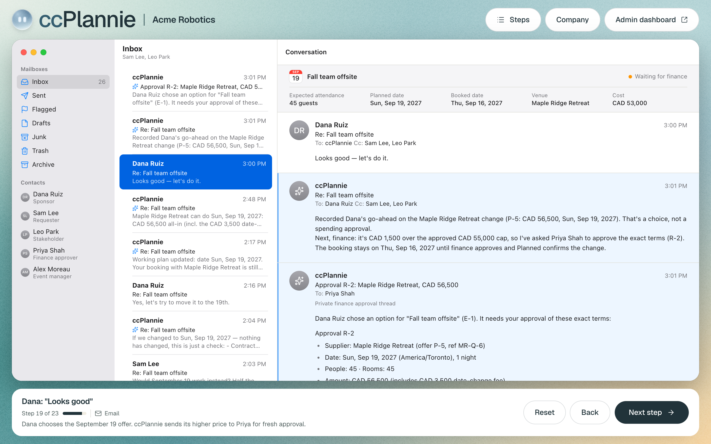
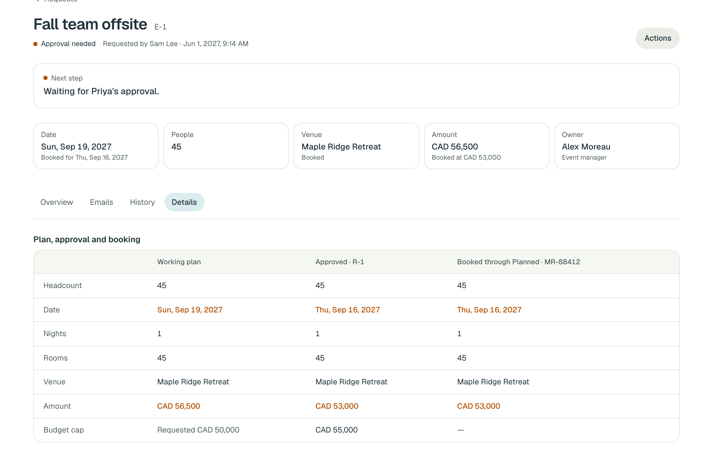

# ccPlannie

**Bring Planned into the email thread.**

ccPlannie is an event coordination assistant built as an extension concept for [Planned](https://planned.com). Employees CC it on an event conversation and keep working from their inbox. It builds the brief, coordinates options and changes, brings the right people into decisions, and gives the event manager a clear path from the first request to a confirmed booking.

The idea is simple: **make participating in the company's event program as easy as replying to an email.**

## The opportunity

An event manager might use Planned every day. The executive assistant organizing an offsite, the team lead choosing a venue, and the colleague suggesting a different date may only plan events occasionally. Their involvement still matters: they supply the requirements, choose between options, and make decisions that affect the event.

Planned's [Adoption Playbook](https://planned.com/adoption-playbook) makes sustained participation a clear priority. Its [sportswear customer story](https://planned.com/customers/consumer-goods) describes smaller events bypassing a previous platform because they did not justify its learning curve. Its [integrations](https://planned.com/products/integrations) already bring event workflows into tools teams use.

ccPlannie explores email as another way to participate. An employee can bring the event team into an existing conversation, get help organizing the event, and stay involved as it develops. The event manager receives a structured request and a workspace to carry it through.

**The goal is broader adoption across the company, more event activity entering the managed program, and a familiar experience people can return to for their next event.**

## The complete workflow

A VP emails an assistant about a team offsite. The assistant adds ccPlannie to the conversation.

ccPlannie captures the brief, asks for missing details, and routes the request to the company's event manager. Once the manager takes ownership and starts sourcing, venue options return to the email thread. Employees discuss the options, adjust requirements, and choose a plan. ccPlannie tracks those decisions, identifies their consequences, and brings finance in when spending needs approval.

The manager authorizes the approved booking, and supplier confirmation establishes what is booked. If the team later changes the headcount or date, ccPlannie carries that change through revised pricing, approval, and confirmation.

| Participant | Their experience |
| --- | --- |
| **Employees, assistants, and sponsors** | Start a request, answer questions, compare options, suggest changes, make permitted decisions, and ask for updates through email. |
| **Event managers** | Own requests, coordinate sourcing, review offers and contract terms, resolve outstanding items, and authorize bookings and amendments from the console. |
| **Finance** | Review exact spending terms in a private approval thread, approve or decline within their limit, and reassess changes that need fresh approval. |
| **Company administrators** | Manage the directory, roles, spending limits, routing, and workflow rules that determine how ccPlannie handles requests. |

## Features

### Email coordination

- **CC or forward a conversation** to turn an event request into a structured brief.
- **Capture event requirements** including dates, location, headcount, nights, room needs, and requested budget.
- **Ask targeted follow-up questions** when information needed to move forward is missing.
- **Keep replies connected to the request**, including forwarded context and separate approval conversations.
- **Share options, explain changes, and answer status questions** in the email thread, while leaving routine acknowledgments quiet.

### Venue options and changing requirements

- **Coordinate quote requests** with the event's current dates, attendance, and accommodation needs.
- **Compare returned offers** by price, capacity, availability, and included terms.
- **Track revised offers** when requirements change and identify quotes that need reconfirmation.
- **Surface change impacts** including capacity conflicts, contract fees, differences from the requested budget, and amounts above the approved cap.
- **Review contract clauses against their source excerpts** before relying on extracted conditions. Missing prices and unconfirmed availability remain visible.

### Decisions, approvals, and bookings

- **Apply company-defined authority** to distinguish suggestions, scope decisions, spending approvals, and booking authorization.
- **Request private finance approval** for the exact venue, dates, headcount, amount, and terms being considered.
- **Enforce approval limits and escalation**, with reassignment to an eligible approver when a request exceeds the assigned person's limit.
- **Record approvals and declines**, request fresh approval for revised terms, and preserve earlier decisions in the history.
- **Require manager authorization and supplier confirmation** before recording a booking or amendment as confirmed.
- **Keep the working plan, approved terms, and supplier commitment separate**, preserving the existing booking while a proposed change progresses.

### Event manager workspace

- **Search and filter the request inbox** by ownership, stage, and outstanding work, including requests waiting on employees, finance, or suppliers.
- **See the next action and responsible person** alongside missing details, pending decisions, stale quotes, and review items.
- **Route and reassign requests**, with explicit ownership acceptance by the event manager.
- **Review conversations, offers, approvals, and booking details** from the same request.
- **Pause and resume coordination**, resolve flagged items, and record decisions made on a call or outside the email thread with the decision-maker and source noted.
- **Review held intake** and reprocess eligible messages once directory or permission issues are resolved.

### Company directory and policy

- **Import, preview, edit, and export the company directory** through CSV or the browser.
- **View reporting relationships and backup contacts**, with roles and spending limits attached to individual people.
- **Define and edit roles and permissions**, so company policy determines who may request, decide, approve, and manage events.
- **Configure routing, finance approvers, supplier response deadlines, and automatic requests for revised quotes.**
- **Build workflow rules visually**, adding review pauses, FYI messages, copied participants, and approval escalation at specific stages.
- **Turn a written policy into proposed settings**, review the changes and any active requests affected, then save the configuration.

### Follow-through, history, and connections

- **Flag overdue supplier replies** and clear the corresponding warnings when answers arrive.
- **Retry failed outgoing messages** while preserving the original request and approval context.
- **Trace decisions to their source emails**, with a separate activity log for company configuration and routing changes.
- **Export the full request record as JSON**, including the plan, approvals, confirmed terms, and supporting history.
- **Inspect the proposed Planned exchanges** for event briefs, offers, booking requests, amendments, and confirmations.
- **See the status** of email transport, interpretation, directory and policy sources, and the Planned integration boundary.

## See it in action

The Acme scenario follows an offsite from its first email through booking and a later date change.

The team starts at 30 guests, then expands to 45. ccPlannie updates the plan after the sponsor confirms the change, identifies the old quotes as stale, and coordinates a revised offer. Finance approves Maple Ridge at CAD 53,000 with a CAD 55,000 spending cap, and the booking is confirmed for September 16.

Later, the team asks about September 19. The new offer includes a **CAD 3,500 contract fee**, bringing the price to **CAD 56,500**. ccPlannie explains the difference, requests fresh finance approval when the sponsor chooses the revised offer, and keeps the original booking in place until the change is confirmed.



*The employee experience: continue the conversation, see the implications, and bring the right person into the next decision.*



*The event manager experience: see what people want, what finance approved, what is booked, and what needs to happen next.*

| Scenario | Focus |
| --- | --- |
| **Acme Robotics** | The complete event journey: intake, venue options, changing headcount, approval, booking, and a date change with a contract fee. |
| **Northwind Labs** | Company authority: spending limits, approval escalation, reassignment, changing roles, sender checks, and held intake. |
| **Juniper Works** | Operational coordination: configurable rules, decisions recorded from calls, late replies, delivery recovery, a finance decline, and an approved alternative. |

## Run it

Use Node.js 24 and npm 11:

```bash
npm ci
npm run demo
```

Open [localhost:3000](http://localhost:3000) and choose a scenario. **Next step** advances the story, **Admin dashboard** opens the corresponding company workspace, and **Steps** lets you revisit earlier moments.

The standalone company console is available through `npm run console`. Configuration, deployment, and provider setup are covered in the [development guide](docs/development.md).

## Technical overview

### Stack

| Layer | Tools |
| --- | --- |
| **Frontend** | React 19 and TypeScript, built with Vite 8. Tailwind CSS 4 and Base UI for the interface, Lucide icons, and d3-org-chart for the People chart. |
| **Server** | Node.js 24 with its built-in HTTP server and SQLite (`node:sqlite`). No web framework and no external database for local use. |
| **AI** | Google Gemini (default: Gemini 3.8 Flash, through a Google AI Studio API key or Vertex AI, using `@google/genai`), or Anthropic Claude (API or Vertex AI). Zod schemas validate every model answer. |
| **Email** | [AgentMail](https://agentmail.to) gives ccPlannie its own inbox through an API: it polls for new mail, sends replies, and uses AgentMail's DKIM/DMARC results to verify senders. Gmail (IMAP and SMTP through `imapflow`, `nodemailer` and `mailparser`) and Postmark are alternatives. |
| **Hosting** | Vercel for the site and a serverless API function; Upstash Redis keeps one demo session per visitor. |
| **Testing** | Node's test runner, `fast-check` property tests, and `playwright-core` for screenshots. |

### How the AI is used

The model never acts on its own:

- **Reading email.** It turns an email into *proposed* intents ("change headcount to 45", "choose option 2", "approve R-2"). Plain code then checks who sent it, what their role allows, and whether the terms match, before anything changes (`src/interpret.mjs`, `src/domain.mjs`).
- **Reading policies.** On the Rules page, it reads an uploaded policy document into suggested settings that an admin reviews before saving (`src/policy-import.mjs`).

The demo's story emails replay recorded readings, so the demo works without an API key and always plays the same way.

### How the pieces connect

```
email (AgentMail / Gmail / Postmark)
  → interpret.mjs   the model proposes what the email means
  → domain.mjs      code checks permissions, approvals and limits; updates plan / approval / booking
  → SQLite          request record, history, company setup, outgoing email queue
  → console + replies in the email thread
  ↔ planned.mjs     where Planned would connect (simulated venues today)
```

### Connecting to Planned (proposed)

The company's Planned admin would authorize ccPlannie through Planned's supported integration (Planned lists MCP and Zip among its [integrations](https://planned.com/products/integrations)). ccPlannie would send Planned the event brief once a manager accepts the request, and later only the exact, finance-approved terms to book or change. Planned would send back venue options, revised prices with contract fees, and booking confirmations with references. Internal email discussion, approval codes and budget caps would stay in ccPlannie. Today this exchange is simulated (`src/planned.mjs`, `src/supplier-sim.mjs`).

The application checks permissions and event state before applying interpreted decisions. Persistent records, duplicate-message handling, version checks, and delivery retries support continuity as the conversation progresses. Scenario replays and historical snapshots make the workflow repeatable and inspectable.

```bash
npm test
npm run replay -- acme
```

**Integration status:** ccPlannie is an independent extension concept for Planned. The event workflow and company console are implemented; the current Planned handoff uses simulated venue offers, contracts, and confirmations. A live connection would use Planned's supported authentication and integration interfaces.

[Demo guide](docs/demo-guide.md) · [Product rationale](docs/product-rationale.md) · [Development guide](docs/development.md)
